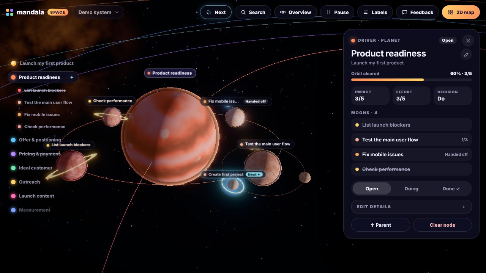

# Mandala

**Mandala is a local-first visual tool for breaking a goal down, deciding what matters, and doing the next useful thing.**

You put one goal in the center, grow it into the drivers that move it, break those into actions and smaller steps, decide what to do with each one — and Mandala tells you the next concrete move. The whole structure stays visible on a zoomable canvas, in a table, in a classic 9×9 grid, or as a 3D solar system you can fly through.

> **Break it down → Decide → Do next → Review**

**Try the beta:** https://mandala-chart.yorulmazyln.workers.dev — no account, nothing to install, your maps stay in your browser.



> **Beta.** Things may still break. Use **Save** to keep a backup of maps you care about, and **Feedback** in the top bar to report bugs or ideas ([GitHub Issues](https://github.com/ylnyorulmaz/mandala-chart/issues/new/choose)).

---

## Contents

- [Why Mandala](#why-mandala)
- [Features](#features)
- [Quick start](#quick-start)
- [Keyboard shortcuts](#keyboard-shortcuts)
- [The Space view (3D)](#the-space-view-3d)
- [Your data and privacy](#your-data-and-privacy)
- [Run locally](#run-locally)
- [Project structure](#project-structure)
- [Architecture](#architecture)
- [Data model](#data-model)
- [Deploy (Cloudflare)](#deploy-cloudflare)
- [Testing](#testing)
- [Feedback and contributing](#feedback-and-contributing)
- [Documentation](#documentation)
- [Limitations and roadmap](#limitations-and-roadmap)
- [License](#license)

---

## Why Mandala

Most productivity software starts after you already know what to do. Mandala starts earlier — in the gap between **knowing what you want** and **knowing what to do next**, where hesitation and planning loops live.

The structure is always the same:

> **Goal → Drivers → Actions → Steps**

- **Goal** — the one outcome in the center.
- **Drivers** — up to eight things that must move for the goal to happen.
- **Actions** — concrete, controllable work under each driver.
- **Steps** — smaller pieces, only when an action is still too broad.

Mandala borrows from Mandala/Mandalart charts, divide-and-conquer, work breakdown structures, controllable-action thinking, Definition of Done, Impact/Effort, Eisenhower-style triage, the 4Ds, dependencies, and feedback loops — but keeps all of that **under the hood**. On screen there are only four moves: break it down, decide, do the next thing, review.

The acceptance test is not "does the map look cool?" but:

> **Did using Mandala cause useful actions to happen that would otherwise have been postponed?**

See [Product.md](Product.md) and [ExecutionFramework.md](ExecutionFramework.md) for the full reasoning.

---

## Features

### Planner (2D)

- **Map view** — a persistent, zoomable mind-map: pan, pinch/scroll zoom, fit, focus, minimap, branch collapse, drag nodes to rearrange, spatial arrow-key navigation.
- **Table view** — the decision surface: status, decision, impact, effort, readiness and time in rows (readable cards on phones).
- **Grid view** — the classic 9×9 Mandala chart (screens ≥ 1024 px): goal in the center, eight drivers around it, each driver's eight actions in its own 3×3 block.
- All three views read and write the **same nodes** — they are projections, not copies.

### Deciding and doing

- **Decisions:** Do / Later / Hand off / Drop. Later asks for a date, Hand off for a person; Drop parks work without deleting it.
- **Impact / Effort** sliders, optional **estimate**, **notes**, and a lightweight **Blocked by** dependency.
- **Next move** — picks the best ready action: an unfinished leaf, decided as Do, not blocked, not under a parked branch; sorted by impact, effort, "already doing" and short estimates.
- **Quest progress**, direct check-off, short celebrations.
- **Review** — a quick look at what is done, ready, deferred, handed off, dropped, and blocked, with prompts to revise the plan.

### Maps library

- Multiple independent maps, all stored locally.
- **Autosave history** — up to 30 versions per map; restoring saves the current version first.
- Optional structure *between* maps: a loose **Group**, **Related to**, **Comes before / after**, **Parent / child** (cycles are blocked).
- **Backup and restore** — **Save** downloads a map as JSON, **Import map** brings it back as a new map (validated and cleaned on the way in).

### Space (3D)

- The active map as a **solar system**: goal = sun, drivers = planets, actions = moons, steps = moonlets.
- Fly to any body, follow it along its orbit, see decisions, blockers and the next move, and **edit** everything from the side panel.
- Stays in sync with an open planner tab. Details in [The Space view](#the-space-view-3d).

### Everywhere

- Installable **PWA**, works offline after the first visit.
- Four palettes: Light, Dark, Sage, Dawn.
- Phone-friendly layout with safe-area support; Grid is hidden on small screens.
- `prefers-reduced-motion` is respected.
- No account, no server, no analytics.

---

## Quick start

1. Open the [live beta](https://mandala-chart.yorulmazyln.workers.dev) (or [run it locally](#run-locally)).
2. Click the prompt in the middle and type your goal. Eight empty driver slots appear around it.
3. Double-click a slot (or select it and press **Edit**) to name a driver. Use **+ Branch** to give a driver its eight action slots; branch again only if an action is still too big.
4. Open **Inspect** on a node to set the decision, impact/effort, a blocker, an estimate, or notes. The **Table** view is the fastest place to decide many nodes at once.
5. Press **Next move** (or Ctrl/⌘ + K) and do that one thing. Tick it off.
6. Switch to **Space ✦** to see the whole plan as a solar system, or press **Review** when reality changes.
7. Use **Maps → Save** now and then to keep a backup file.

---

## Keyboard shortcuts

### Planner

| Key | Action |
|---|---|
| ← ↑ → ↓ | Hop to the nearest visible node in that direction (Map view) |
| Shift + arrows | Pan the canvas without changing the selection |
| + / − | Zoom in / out |
| F | Fit the whole map |
| Ctrl/⌘ + K | Next move |
| Double-click a node | Edit its title inline (Enter saves) |
| Esc | Close the inspector / dialogs, cancel inline editing |

### Space

| Key | Action |
|---|---|
| N | Fly to the next move |
| / | Search node titles |
| ← / → | Previous / next sibling |
| ↑ / ↓ | Parent / first child |
| E | Edit the focused body's title |
| B | Add a branch (eight empty slots) |
| D | Toggle done |
| Space | Pause / resume orbits |
| L | Show / hide labels |
| Esc | Close search, go up a level, or return to the overview |

---

## The Space view (3D)

`space.html` turns the active map into a solar system.

| Map | Space |
|---|---|
| Goal | the **sun** in the center |
| Driver | a **planet** on its own orbit, with a generated surface (gas giant, terra, ice, rock) |
| Action | a **moon** circling its planet |
| Step | a **moonlet** circling its moon |
| Empty slot | a faint **wireframe** body — name it and it becomes a real world |

What you can see:

- **Done** bodies wear a golden ring; **Doing** bodies pulse.
- **Later** bodies are faded, **Drop** bodies are grey ghosts, **Hand off** bodies carry a small blue courier, and anything under a parked parent is dimmed.
- A **blocked** node gets a dashed red line to its blocker and a "Blocked" tag.
- The **next move** (same rule as the planner) wears a pulsing cyan beacon.

What you can do:

- Drag to rotate, scroll/pinch to zoom, right-drag/two-finger drag to pan. Grabbing the camera during a flight cancels the flight.
- Click a body, a label, a search result or a list item to fly there; the camera follows it while time slows down.
- In the side panel: set **Open / Doing / Done**, **rename** (pencil, double-click or E), and under **Edit details** change impact, effort, decision, hand-off target, bring-back date, estimate, blocker and notes. **+ Branch** adds eight empty slots; **Clear node** (press twice) empties a node and removes its subtree.
- The map picker switches maps; **2D map** opens the planner on the body you are looking at.

Working together with the planner:

- **Space ✦** in the planner's view switcher saves the map first and opens Space on the selected node (`space.html?map=…&node=…`).
- An open planner tab and Space stay in sync: every edit in Space is applied by the planner too, and planner saves update Space live. Neither side overwrites the other.

Performance and compatibility:

- Planet textures are painted in small slices after the first frame and cached across edits.
- Phones and low-core devices use a lower pixel ratio and no MSAA; the pixel ratio also steps down automatically when the frame rate stays under ~40 fps.
- Requires WebGL 2 and import maps (current Chrome, Edge, Firefox, Safari 16.4+). Otherwise Space explains why and links back to the planner.

Still planner-only: dragging nodes, collapsing branches, Ideas (suggestions), and map groups / relationships.

---

## Your data and privacy

- Everything lives in **your browser's IndexedDB**, on your device. There is no server, no account and no analytics.
- Data is per browser and per site address: another browser, device, or domain starts with an empty library.
- Clearing site data deletes your maps. **Save** regularly if a map matters; **Import map** restores it anywhere.
- The **Feedback** and **Report it** links open a GitHub issue form with technical details (page, app version, browser, screen size, WebGL support). They never include map contents, and nothing is sent unless you submit the form yourself.

---

## Run locally

There is no build step. Serve the folder over HTTP (needed for IndexedDB, ES modules and the service worker):

```sh
python3 -m http.server 8080
# then open http://localhost:8080
```

Any static server works (`npx serve`, `npx wrangler dev`, …). Opening `index.html` directly from the file system is not supported.

When you change a cached file during development, the service worker may serve the old copy once; reload again or use DevTools → Application → "Update on reload".

---

## Project structure

```
index.html            Planner shell: header, Map / Table / Grid views, inspector, modals
app.js                Planner: state, layout, camera, editing, views, decisions, next move,
                      review, maps library, import/export, sync with Space
styles.css            Visual system for the planner, About and Blog
storage.js            MandalaStorage — IndexedDB maps, snapshots, meta, map links
map-ops.js            MandalaOps — edit operations shared by Space and the planner
feedback.js           Feedback links and the "Report it" error notice; APP_VERSION

space.html            Space page: import map, panel, search, fallbacks
space.css             Space styles
space.js              Space scene, camera flights, labels, panel, editing, sync
space/model.js        Progress / decision / blocker / next-move rules (mirror app.js)
space/textures.js     Procedural planet, glow and nebula textures
space/shaders.js      Sun, atmosphere, ring and point-sprite materials

about.html, blog.html Public pages
sw.js                 Service worker (offline cache; CACHE_NAME)
manifest.webmanifest  PWA manifest
icon.svg              App icon

vendor/               Pinned third-party libraries (no CDN at runtime)
tests/                Playwright tests: unit/ (no browser), e2e/ (browser), fixtures/ (test maps)
package.json          Dev-only tools: @playwright/test, wrangler (the app has no build step)
playwright.config.js  Test projects (unit, e2e) and browser settings
docs/                 README images (not published)
.github/              Issue forms (not published)

wrangler.jsonc        Cloudflare Workers static-assets config
.assetsignore         Files kept out of the published site
_headers              Response headers (sw.js revalidation, nosniff, referrer policy)

Product.md, ProductRoadmap.md, ExecutionFramework.md   Product thinking
Agents.md, Claude.md                                    Guides for coding agents
```

---

## Architecture

### Principles

- **Static and local-first.** HTML, CSS and plain JavaScript; no framework, no bundler, no backend.
- **No runtime CDNs.** Every library is vendored and version-pinned in `vendor/`. (A CDN failure once broke the app; it must not happen again.)
- **One data model.** Map, Table, Grid and Space are views of the same node objects.

### Planner (`index.html` + `app.js`)

`app.js` is a single jQuery IIFE that owns the in-memory `state` (`{ rootId, nodes, version }`), renders the three views, and persists through `MandalaStorage`. Saves are debounced (~220 ms); autosave snapshots are deduplicated and rate-limited.

### Storage (`storage.js`)

IndexedDB database `mandala-local`, schema version **2**, through the vendored `idb` wrapper:

| Store | Contents |
|---|---|
| `maps` | one record per map: `{ id, title, group, createdAt, updatedAt, state }` |
| `snapshots` | autosaved versions, newest 30 per map |
| `meta` | e.g. the active map id |
| `mapLinks` | relationships between maps: `related`, `before`, `parent` |

Older single-map `localStorage` data is migrated on first start. Palette choice stays in `localStorage`. If IndexedDB is unavailable the planner falls back to a single map in `localStorage` and says so.

### Space (`space.html` + ES modules)

`space.html` loads Three.js, postprocessing and GSAP through an **import map** (only on this page, so the planner stays light). `space.js` builds the scene from the stored map:

- `space/model.js` holds the rules for progress, decisions, blockers and the next move — a deliberate mirror of the functions in `app.js` so both views always agree.
- Bodies are nested pivots (sun → orbit → planet → moon ring → moon …); labels are DOM chips projected every frame and de-overlapped by priority.
- Post-processing: bloom, AgX tone mapping, vignette, and subtle chromatic aberration (off with reduced motion).

### Editing and sync (`map-ops.js` + `BroadcastChannel`)

All edits made in Space are expressed as **ops** that both pages understand:

| Op | Meaning |
|---|---|
| `{ op: "update", id, fields }` | change title, status, impact, effort, decision, duration, notes, delegatedTo, deferUntil or dependencyId (validated) |
| `{ op: "addSlots", parentId, ids }` | add eight empty children (ids chosen by the sender, so both sides match) |
| `{ op: "clear", id }` | empty a node, remove its subtree, clear dependencies on it |

Flow on the `mandala-sync` channel:

1. Space applies the ops to its copy, writes them to IndexedDB, then posts `{ type: "ops", mapId, ops }`.
2. An open planner tab applies the same ops to its in-memory state and saves — so its next autosave cannot overwrite the change.
3. Whenever the planner saves, it posts `{ type: "map-saved", mapId }`; Space reloads the record and updates in place, or rebuilds the system (keeping focus) when bodies were added or removed.

`map-ops.js` mirrors `createNode`, `createEightSlots`, `clearSelectedNode` and `populateDependencyOptions` in `app.js`; change them together.

### Deep links

- `space.html?map=<id>&node=<id>` opens Space on a node (the `node` parameter is removed after use).
- `index.html?node=<id>` opens the planner with that node selected and focused.

### Offline (`sw.js`)

- App files are precached; HTML/CSS/JS of the app are served **network-first** so updates arrive, other files cache-first.
- The 3D libraries are cached on first use, not at install, so planner-only users never download them.
- `CACHE_NAME` in `sw.js` and `APP_VERSION` in `feedback.js` share one value (currently `mandala-v32`); bump both whenever a cached file changes.

---

## Data model

A node is plain, serializable JSON:

| Field | Type | Notes |
|---|---|---|
| `id` | string | `n_<time36>_<random>` |
| `title` | string | ≤ 180 chars; empty = empty slot |
| `parentId` | string \| null | `null` for the goal |
| `depth` | number | 0 goal, 1 driver, 2 action, 3+ step |
| `children` | string[] | ordered; drivers are placed clockwise N, NE, E, SE, S, SW, W, NW |
| `status` | `open` \| `doing` \| `done` | |
| `decision` | `do` \| `defer` \| `delegate` \| `delete` | shown as Do / Later / Hand off / Drop; `delete` never deletes the node |
| `impact`, `effort` | 1–5 | default 3 |
| `dependencyId` | string \| null | "Blocked by" |
| `delegatedTo` | string | Hand off target |
| `deferUntil` | `YYYY-MM-DD` or `""` | Later date |
| `duration` | string | estimate in minutes |
| `notes` | string | ≤ 1200 chars |
| `collapsed`, `tableCollapsed` | boolean | view state |
| `offsetX`, `offsetY` | number | manual position offset in the map |
| `createdAt` | number | epoch ms |

**Export file** (`Save`): `{ exportedAt, version, rootId, nodes }`. **Import** accepts that format (or a bare `{ rootId, nodes }`), rebuilds the tree from the root, drops orphaned or malformed nodes, validates every field, and stores the result as a new map (limits: 5 MB, 5000 nodes).

---

## Deploy (Cloudflare)

Mandala is deployed as a static site with Cloudflare **Workers Static Assets**:

```sh
npx wrangler deploy
```

- `wrangler.jsonc` serves the repository folder as-is. `html_handling: "none"` keeps `/space.html` and the other paths exactly as `sw.js` caches them.
- `.assetsignore` keeps Markdown, `docs/`, `.github/`, `tests/`, `package.json`, `LICENSE` and config out of the published site.
- `_headers` makes browsers revalidate `sw.js` and adds `nosniff` / referrer-policy headers.

**Automatic deploys:** connect the Worker to this repository in the Cloudflare dashboard (Workers & Pages → `mandala-chart` → Settings → Builds → Connect; branch `main`, no build command, deploy command `npx wrangler deploy`). Every push to `main` then publishes.

Live: https://mandala-chart.yorulmazyln.workers.dev

---

## Testing

The test suite uses [Playwright](https://playwright.dev) and needs Node 18+. The app itself still has no build step — `package.json` only holds dev tools.

```sh
npm install                          # once
npx playwright install chromium      # once, if Chromium for Playwright is not installed yet
npm test                             # everything (~1.5 min)
npm run test:unit                    # fast checks without a browser (< 1 s)
npm run test:e2e                     # browser tests
npx playwright test tests/e2e/space.spec.js -g "Clear"   # one file / one test
npm run test:headed                  # watch the browser
```

No web server is needed: the tests answer every request to `http://mandala.test/` straight from the repository files (`tests/e2e/fixtures.js`). Space renders with software WebGL (SwiftShader), so no GPU is needed either.

| File | What it protects |
|---|---|
| `tests/unit/model.spec.js` | `space/model.js`: decisions, suppressed branches, blockers, progress, next move, structure signature |
| `tests/unit/map-ops.spec.js` | `map-ops.js`: every op, validation, no-op on bad input, id format, blank node fields |
| `tests/unit/release.spec.js` | `CACHE_NAME` = `APP_VERSION`, precache list complete, no CDNs, private files unpublished, licenses present |
| `tests/e2e/parity.spec.js` | **planner and Space agree** on progress and next move for nine seeded random maps (chosen so changing any part of the score formula is caught) |
| `tests/e2e/planner.spec.js` | first run, naming / branching / clearing, Map–Table–Grid, Save → Import, hostile import files, deep links |
| `tests/e2e/layout.spec.js` | the view switcher never covers planner actions or the zoom toolbar (1600 → 390 px) |
| `tests/e2e/space.spec.js` | demo system, Next / search / keyboard, every edit type, camera grab during a flight, full-motion run, import-map fallback, phone layout |
| `tests/e2e/sync.spec.js` | Space edits reach an open planner tab and survive its autosave; planner saves update Space |
| `tests/e2e/feedback.spec.js` | Feedback links on every page, no map contents in reports, one "Report it" notice per page |

Shared helpers: `tests/e2e/fixtures.js` (routing, error tracking — every browser test fails on a console error — `seedMap`, `openPlanner`, `openSpace`, `focusInSpace`, `clickNode`) and `tests/fixtures/maps.js` (`buildMap`, `marathonMap`, seeded `randomMap`).

**CI:** `.github/workflows/test.yml` runs `npm test` on every push to `main` and on pull requests, and uploads the report when something fails.

Still checked by hand: real phones and GPUs (iPhone Safari, Android Chrome), offline reload after a visit, and how it *feels*.

---

## Feedback and contributing

Mandala is in beta, and feedback is the most useful contribution right now:

- **Feedback** (top bar on every page) opens a GitHub issue form with your environment filled in.
- If something crashes, a small **Report it** notice opens the bug form with the error attached.
- Or go straight to [Issues](https://github.com/ylnyorulmaz/mandala-chart/issues/new/choose).

Code changes are welcome too. Run `npm test` before opening a pull request, and please read [Agents.md](Agents.md) first — it lists the hard rules (no CDNs, no framework rewrite, local-first, keep `map-ops.js` / `space/model.js` in step with `app.js`, bump the cache version) and the checks a change must pass.

---

## Documentation

| File | What it covers |
|---|---|
| [Product.md](Product.md) | Vision, philosophy, audience, capabilities, constraints, business hypothesis |
| [ExecutionFramework.md](ExecutionFramework.md) | The decomposition → decision → next move → review model |
| [ProductRoadmap.md](ProductRoadmap.md) | Staged roadmap: hardening, dogfooding, AI assistance, optional sync, validation |
| [Agents.md](Agents.md) | Rules, invariants and checklists for anyone (or any agent) changing the code |
| [Claude.md](Claude.md) | Orientation guide for coding assistants: how the code fits together and where to change what |
| [about.html](about.html) | Public explanation of the method |
| [blog.html](blog.html) | Essays; the first post tells the Shohei Ohtani goal-chart story |

---

## Limitations and roadmap

Intentionally not here yet:

- accounts, cloud backup or cross-device sync (use Save / Import),
- live AI — the **Ideas** button uses local demo suggestions; a future AI layer should critique and assist with structured, confirmable changes,
- collaboration, notifications, integrations, payments, native apps,
- a visual "map of maps" (relationships are managed in the Maps library),
- real-device QA across all phones and GPUs is still in progress.

Mandala should prove repeated usefulness before it grows. See [ProductRoadmap.md](ProductRoadmap.md).

---

## License

Mandala is released under the [MIT License](LICENSE).

Third-party libraries in `vendor/` keep their own licenses:

| Library | Version | License |
|---|---|---|
| [jQuery](https://jquery.com) | 3.7.1 | MIT — `vendor/jquery-LICENSE.txt` |
| [idb](https://github.com/jakearchibald/idb) | 6.1.5 | ISC — `vendor/idb-LICENSE.txt` |
| [three.js](https://threejs.org) | 0.180.0 | MIT — `vendor/three/LICENSE.txt` |
| [postprocessing](https://github.com/pmndrs/postprocessing) | 6.39.6 | Zlib — `vendor/postprocessing/LICENSE.txt` |
| [GSAP](https://gsap.com) | 3.13.0 | GSAP Standard "No Charge" License — `vendor/gsap/LICENSE.txt` |
